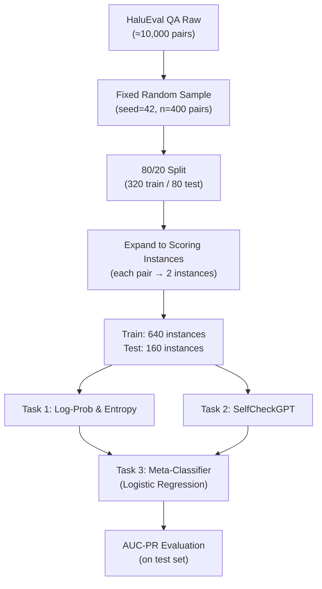

# HaluEval QA Dataset — Setup Guide & Code

## 1. Understanding the Assignment Instructions

### 1.1 What Is the Dataset?

The **HaluEval QA subset** is a hallucination evaluation benchmark created by [RUCAIBox](https://github.com/RUCAIBox/HaluEval). It contains **≈10,000 question-answer pairs**, where each pair has:

| Field                  | Type   | Meaning                                                        |
| :--------------------- | :----- | :------------------------------------------------------------- |
| `knowledge`            | string | Wikipedia context passage (background knowledge)               |
| `question`             | string | The question (originally from HotpotQA)                        |
| `right_answer`         | string | The correct, factual answer                                    |
| `hallucinated_answer`  | string | An LLM-generated plausible-sounding **incorrect** answer       |

### 1.2 Key Instruction Breakdown

> [!IMPORTANT]
> **No official train/test split exists.** You must create your own.

#### Instruction 1: "Draw a fixed random sample for tractability if needed"
- The full dataset has 10,000 pairs. Running LLM inference on all 10,000 is expensive.
- You are allowed (and expected) to **subsample** to a tractable size (e.g., **400 pairs**).
- The sample must use a **fixed random seed** so results are reproducible.

#### Instruction 2: "Build your own 80/20 train/test partition for Task 3"
- After sampling, split the data into **80% train / 20% test**.
- **Train set** → used to train the Task 3 Logistic Regression meta-classifier.
- **Test set** → used to evaluate AUC-PR for all three tasks.
- Use a fixed seed so the split is deterministic.

#### Instruction 3: "Score right_answer and hallucinated_answer directly with forced decoding"
- Unlike other datasets in the assignment where you generate answers yourself, here **both answers are already provided**.
- For each question, you run your LLM's forced decoding on **both** `right_answer` and `hallucinated_answer` to extract log-probabilities and entropy.

#### Instruction 4: "Treat each pair as two separate scoring instances for AUC-PR"
- Each question produces **2 scoring instances**:
  - Instance A: `(question, right_answer)` → label = **0** (not hallucinated)
  - Instance B: `(question, hallucinated_answer)` → label = **1** (hallucinated)
- So 400 sampled pairs → **800 scoring instances** for AUC-PR evaluation.

#### Instruction 5: "Generate resamples for Task 2 (SelfCheckGPT)"
- For Task 2, you must **generate N=20 resampled answers** per question at temperature=1.0.
- Then apply SelfCheck-BERTScore and SelfCheck-NLI to score consistency.
- You must clearly **state your resampling protocol** (which model, temperature, max tokens, prompt format).

### 1.3 Visual Summary of the Data Flow



---

## 2. Data Source Options

You can load the dataset from either of these two sources:

### Option A: Hugging Face `datasets` Library (Recommended)
```python
from datasets import load_dataset
dataset = load_dataset("pminervini/HaluEval", "qa", split="data")
```
- Automatically fetches and caches data into the runtime.
- No manual download or file management needed.

### Option B: Direct Download from GitHub
```bash
wget -O qa_data.json "https://raw.githubusercontent.com/RUCAIBox/HaluEval/main/data/qa_data.json"
```
- Downloads the raw JSON file (~10 MB).
- Useful if `datasets` library has issues or you prefer working with raw JSON.

---

## 3. Google Drive Folder Structure

```
My Drive/
└── NLP_Assignment_2_Project7/
    ├── data/
    │   ├── halueval_qa_raw.json            # Full 10,000 pairs (backup)
    │   ├── halueval_qa_sampled.json        # Fixed sample of 400 pairs
    │   └── train_test_split.json           # 80/20 split indices + seed
    │
    ├── checkpoints/
    │   ├── task1_logprobs_entropy.json      # Task 1 forced decoding results
    │   ├── task2_resamples.json             # 20 generated resamples per question
    │   └── task2_selfcheck_scores.json      # BERTScore & NLI consistency scores
    │
    └── outputs/
        ├── task1_results.json               # Task 1 AUC-PR metrics
        ├── task2_results.json               # Task 2 AUC-PR metrics
        ├── task3_meta_classifier.joblib      # Trained Logistic Regression model
        └── final_comparison.csv              # Task 1 vs 2 vs 3 comparison table
```

---

## 4. Complete Code for `Data-setup.ipynb`

> [!NOTE]
> Copy each section below into a **separate cell** in your Colab notebook.

---

### Cell 1 — Install Dependencies

```python
# ============================================================
# CELL 1: Install required packages
# ============================================================
!pip install datasets -q
print("✓ Dependencies installed.")
```

---

### Cell 2 — Mount Google Drive & Create Folder Structure

```python
# ============================================================
# CELL 2: Mount Google Drive and create project directories
# ============================================================
from google.colab import drive
import os

# Mount Drive
drive.mount('/content/drive')

# Define directory paths
BASE_DIR = "/content/drive/MyDrive/NLP_Assignment_2_Project7"
DATA_DIR = os.path.join(BASE_DIR, "data")
CKPT_DIR = os.path.join(BASE_DIR, "checkpoints")
OUT_DIR  = os.path.join(BASE_DIR, "outputs")

# Create all directories
for d in [DATA_DIR, CKPT_DIR, OUT_DIR]:
    os.makedirs(d, exist_ok=True)
    print(f"✓ Directory ready: {d}")
```

---

### Cell 3 — Download Raw Dataset from Hugging Face

```python
# ============================================================
# CELL 3: Download the full HaluEval QA dataset
# ============================================================
import json
from datasets import load_dataset

print("Fetching HaluEval QA subset from Hugging Face...")
hf_dataset = load_dataset("pminervini/HaluEval", "qa", split="data")

# Convert to list of dicts with clean integer IDs
raw_data = []
for idx, item in enumerate(hf_dataset):
    raw_data.append({
        "id": idx,
        "knowledge": item.get("knowledge", ""),
        "question": item["question"],
        "right_answer": item["right_answer"],
        "hallucinated_answer": item["hallucinated_answer"],
    })

# Save full dataset to Google Drive
raw_path = os.path.join(DATA_DIR, "halueval_qa_raw.json")
with open(raw_path, "w", encoding="utf-8") as f:
    json.dump(raw_data, f, indent=2, ensure_ascii=False)

print(f"✓ Full dataset saved: {raw_path}")
print(f"  Total pairs: {len(raw_data)}")
print(f"\n--- Sample Record ---")
print(json.dumps(raw_data[0], indent=2, ensure_ascii=False))
```

---

### Cell 4 — Create Fixed Random Sample (for tractability)

```python
# ============================================================
# CELL 4: Draw a fixed random sample
#
# Assignment instruction:
#   "draw a fixed random sample for tractability if needed"
#
# We sample 400 pairs (= 800 scoring instances), which is
# sufficient for robust AUC-PR while remaining tractable
# for LLM inference on a T4 GPU.
# ============================================================
import random

RANDOM_SEED = 42
SAMPLE_SIZE = 400  # Adjust if needed (max 10,000)

random.seed(RANDOM_SEED)
sampled_data = random.sample(raw_data, SAMPLE_SIZE)

# Assign clean sequential sample IDs
for i, item in enumerate(sampled_data):
    item["sample_id"] = i

# Save sampled subset to Google Drive
sampled_path = os.path.join(DATA_DIR, "halueval_qa_sampled.json")
with open(sampled_path, "w", encoding="utf-8") as f:
    json.dump(sampled_data, f, indent=2, ensure_ascii=False)

print(f"✓ Sampled subset saved: {sampled_path}")
print(f"  Sample size: {SAMPLE_SIZE} pairs ({SAMPLE_SIZE * 2} scoring instances)")
print(f"  Random seed: {RANDOM_SEED}")
```

---

### Cell 5 — Create 80/20 Train/Test Split

```python
# ============================================================
# CELL 5: Build 80/20 train/test partition
#
# Assignment instruction:
#   "build your own 80/20 train/test partition for Task 3,
#    same convention as Datasets 7.1–7.2."
#
# The split is at the QUESTION level (not instance level).
# Each question's two scoring instances (right_answer and
# hallucinated_answer) stay together in the same partition.
# ============================================================

random.seed(RANDOM_SEED)
indices = list(range(SAMPLE_SIZE))
random.shuffle(indices)

split_point = int(0.8 * SAMPLE_SIZE)  # 320 train, 80 test

train_ids = sorted(indices[:split_point])
test_ids  = sorted(indices[split_point:])

# Save split metadata to Google Drive
split_info = {
    "random_seed": RANDOM_SEED,
    "sample_size": SAMPLE_SIZE,
    "train_size": len(train_ids),
    "test_size": len(test_ids),
    "train_scoring_instances": len(train_ids) * 2,
    "test_scoring_instances": len(test_ids) * 2,
    "train_sample_ids": train_ids,
    "test_sample_ids": test_ids,
}

split_path = os.path.join(DATA_DIR, "train_test_split.json")
with open(split_path, "w", encoding="utf-8") as f:
    json.dump(split_info, f, indent=2)

print(f"✓ Train/Test split saved: {split_path}")
print(f"  Train: {len(train_ids)} questions → {len(train_ids) * 2} scoring instances")
print(f"  Test:  {len(test_ids)} questions → {len(test_ids) * 2} scoring instances")
print(f"  Total: {SAMPLE_SIZE} questions → {SAMPLE_SIZE * 2} scoring instances")
```

---

### Cell 6 — Expand to Scoring Instances

```python
# ============================================================
# CELL 6: Expand pairs into individual scoring instances
#
# Assignment instruction:
#   "Treat each pair as two separate scoring instances
#    for AUC-PR purposes."
#
# For each question, we create:
#   Instance A: (question, right_answer)       → label = 0 (faithful)
#   Instance B: (question, hallucinated_answer) → label = 1 (hallucinated)
# ============================================================

def expand_to_scoring_instances(data, id_list):
    """
    Convert question-level data into individual scoring instances.
    Each question produces exactly 2 instances.
    """
    instances = []
    for sample_id in id_list:
        item = data[sample_id]

        # Instance A: Right answer (NOT hallucinated → label 0)
        instances.append({
            "instance_id": f"{sample_id}_right",
            "sample_id": sample_id,
            "original_id": item["id"],
            "knowledge": item["knowledge"],
            "question": item["question"],
            "candidate_answer": item["right_answer"],
            "label": 0,  # faithful
            "answer_type": "right_answer",
        })

        # Instance B: Hallucinated answer (IS hallucinated → label 1)
        instances.append({
            "instance_id": f"{sample_id}_hallucinated",
            "sample_id": sample_id,
            "original_id": item["id"],
            "knowledge": item["knowledge"],
            "question": item["question"],
            "candidate_answer": item["hallucinated_answer"],
            "label": 1,  # hallucinated
            "answer_type": "hallucinated_answer",
        })

    return instances

# Build train and test scoring instances
train_instances = expand_to_scoring_instances(sampled_data, train_ids)
test_instances  = expand_to_scoring_instances(sampled_data, test_ids)

print(f"✓ Scoring instances created:")
print(f"  Train: {len(train_instances)} instances "
      f"({sum(1 for x in train_instances if x['label']==0)} faithful + "
      f"{sum(1 for x in train_instances if x['label']==1)} hallucinated)")
print(f"  Test:  {len(test_instances)} instances "
      f"({sum(1 for x in test_instances if x['label']==0)} faithful + "
      f"{sum(1 for x in test_instances if x['label']==1)} hallucinated)")
print(f"\n--- Sample Scoring Instance ---")
print(json.dumps(train_instances[0], indent=2, ensure_ascii=False))
```

---

### Cell 7 — Verify GPU & Print Summary

```python
# ============================================================
# CELL 7: Verify GPU availability and print project summary
# ============================================================
import torch

print("=" * 60)
print("        PROJECT 7 — DATA SETUP SUMMARY")
print("=" * 60)

# GPU Check
if torch.cuda.is_available():
    gpu_name = torch.cuda.get_device_name(0)
    gpu_mem  = torch.cuda.get_device_properties(0).total_mem / (1024**3)
    print(f"  GPU:           {gpu_name} ({gpu_mem:.1f} GB)")
else:
    print("  GPU:           ⚠ NOT AVAILABLE (switch runtime to GPU!)")

# Dataset Summary
print(f"\n  Dataset:       HaluEval QA (pminervini/HaluEval)")
print(f"  Source:        https://github.com/RUCAIBox/HaluEval")
print(f"  Full size:     {len(raw_data)} question-answer pairs")
print(f"  Sampled size:  {SAMPLE_SIZE} pairs (seed={RANDOM_SEED})")
print(f"  Train split:   {len(train_ids)} pairs → {len(train_ids)*2} scoring instances")
print(f"  Test split:    {len(test_ids)} pairs → {len(test_ids)*2} scoring instances")

# File Locations
print(f"\n  Files saved to Google Drive:")
print(f"    Raw data:    {raw_path}")
print(f"    Sample:      {sampled_path}")
print(f"    Split info:  {split_path}")
print(f"    Checkpoints: {CKPT_DIR}/")
print(f"    Outputs:     {OUT_DIR}/")
print("=" * 60)
print("\n✓ Data setup complete. Ready for Task 1, 2, and 3.")
```

---

## 5. Quick Reference: How to Load Data in Task Notebooks

When you start working on Task 1, 2, or 3 in a **separate notebook**, load the prepared data like this:

```python
import json
import os

# Mount Drive
from google.colab import drive
drive.mount('/content/drive')

BASE_DIR = "/content/drive/MyDrive/NLP_Assignment_2_Project7"

# Load sampled data
with open(os.path.join(BASE_DIR, "data/halueval_qa_sampled.json")) as f:
    sampled_data = json.load(f)

# Load train/test split
with open(os.path.join(BASE_DIR, "data/train_test_split.json")) as f:
    split_info = json.load(f)

train_ids = split_info["train_sample_ids"]
test_ids  = split_info["test_sample_ids"]

print(f"Loaded {len(sampled_data)} samples, "
      f"Train: {len(train_ids)}, Test: {len(test_ids)}")
```
